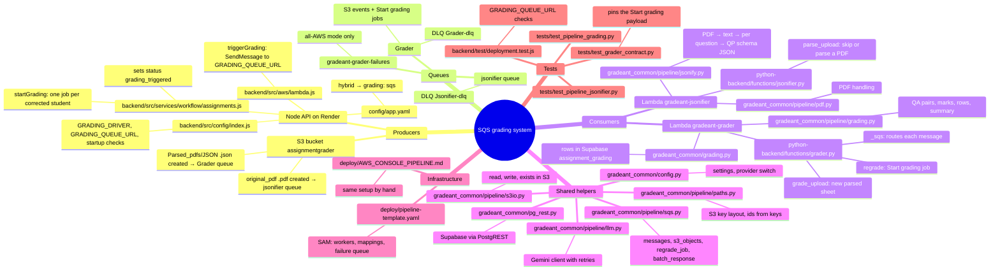
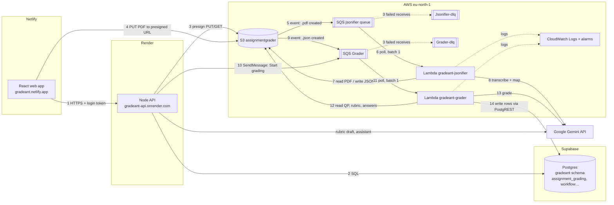
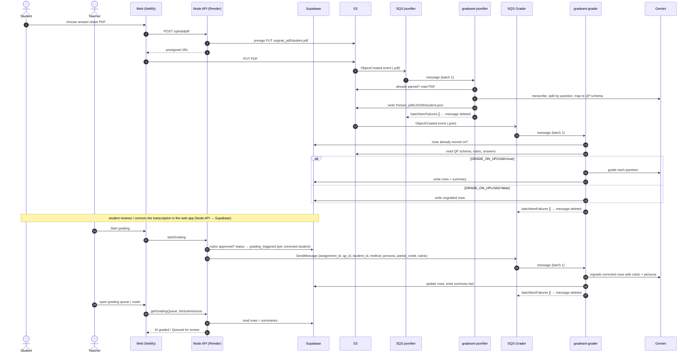
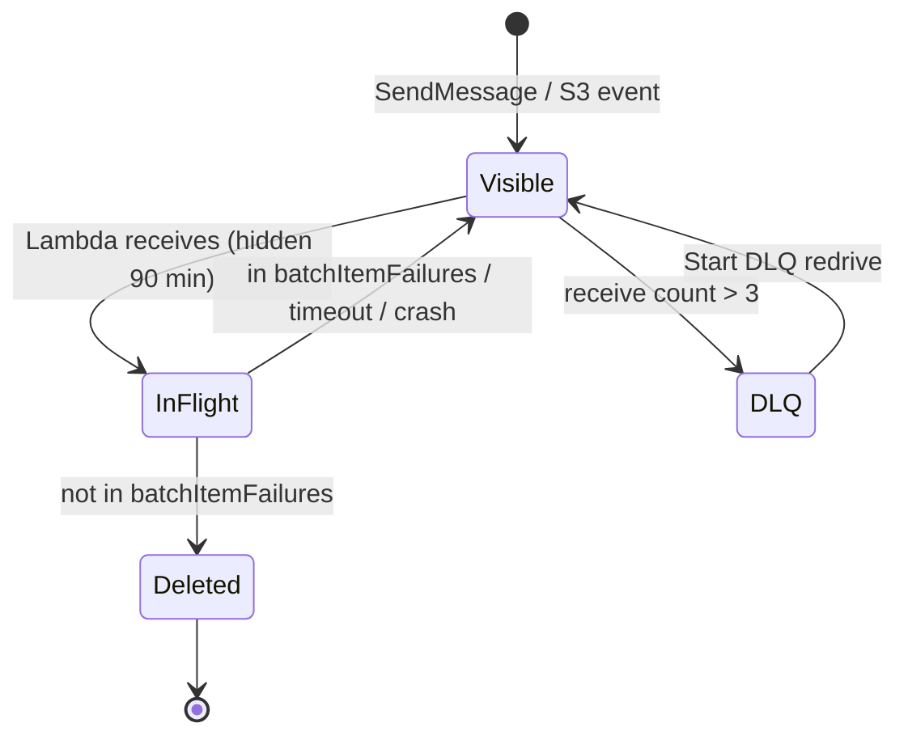
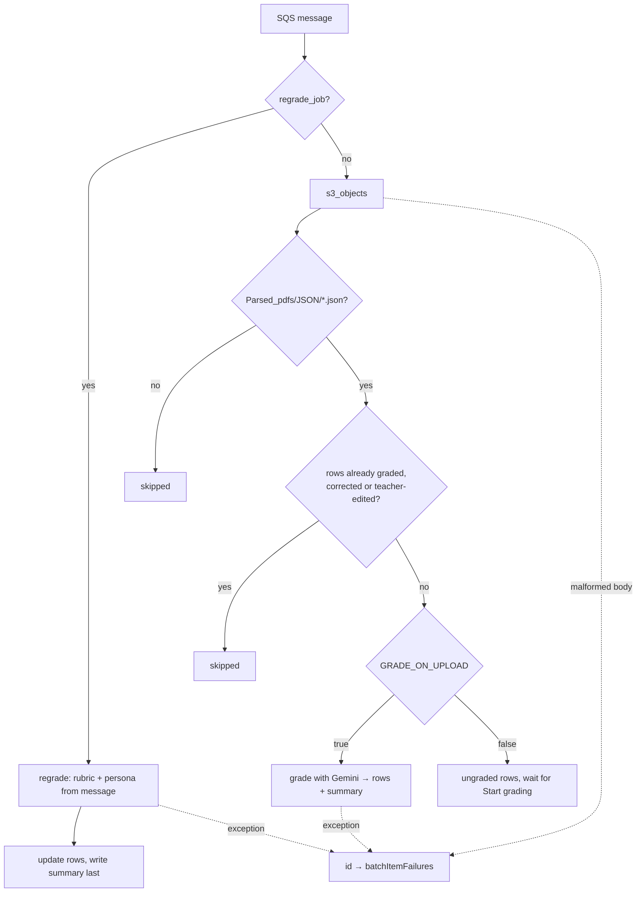

# How the queues work (grading pipeline)

This explains what the SQS queues do, which file handles which part, how every service connects
in the **hybrid** deployment (`deployment: hybrid` in `config/app.yaml`), what events flow
between them, and what happens when something fails. For console setup steps, see
[AWS_CONSOLE_PIPELINE.md](AWS_CONSOLE_PIPELINE.md).

Region: **eu-north-1**. All queues are **Standard** queues (not FIFO).

The diagrams are [Mermaid](https://mermaid.js.org/). GitHub and the VS Code Markdown preview
render them. In a plain text editor, read the tables next to them.

---

## 1. Mind map: who does what in the SQS system



The same thing as a table:

| Part | File | What it does with SQS |
|---|---|---|
| Switch | `config/app.yaml` | `deployment: hybrid` → `grading: sqs` |
| Switch | `backend/src/config/index.js` | reads `GRADING_DRIVER` / `GRADING_QUEUE_URL`, refuses to start if `sqs` has no URL |
| Producer | `backend/src/services/workflow/assignments.js` | `startGrading`: for each student in `corrected` state, sets `grading_triggered` and calls `triggerGrading` |
| Producer | `backend/src/aws/lambda.js` | `triggerGrading`: `SendMessage` (sqs), `Invoke` (lambda) or log only |
| Producer | S3 event notifications | `.pdf` under `original_pdf/` → jsonifier queue; `.json` under `Parsed_pdfs/JSON/` → `Grader` |
| Consumer | `python-backend/functions/jsonifier.py` | reads the jsonifier queue, parses PDFs, writes the parsed JSON |
| Consumer | `python-backend/functions/grader.py` | reads `Grader`, routes S3 events to `grade_upload` and jobs to `regrade` |
| Helper | `gradeant_common/pipeline/sqs.py` | unpacks messages, tells S3 events from jobs apart, builds `batchItemFailures` |
| Helper | `gradeant_common/pipeline/paths.py` | which S3 key is what (assignment, QP, student) |
| Helper | `gradeant_common/pipeline/s3io.py` | S3 reads/writes |
| Helper | `gradeant_common/pipeline/llm.py` | Gemini calls; raises after retries, never returns error text as an answer |
| Helper | `gradeant_common/grading.py` + `pg_rest.py` | writes/reads `gradeant.assignment_grading` in Supabase |
| Infra | `deploy/pipeline-template.yaml` | SAM version: event source mappings (batch 1, `ReportBatchItemFailures`), `PipelineQueuesEnabled` switch |

---

## 2. Hybrid model: how the components connect

In `hybrid`, the web app and the API are off AWS. Only the grading pipeline (S3, SQS, Lambda)
stays on AWS. Gemini does all the AI work, and Supabase is the one database for both the Node API
and the Python grader.



### Every connection, and what it authenticates with

| # | From → To | Protocol | Credential / config | Set in |
|---|---|---|---|---|
| 1 | Web → Node API | HTTPS JSON | user login token; CORS `https://gradeant.netlify.app` | `config/app.yaml` `urls`, Netlify env |
| 2 | Node API → Supabase | Postgres | database connection string | Render env |
| 3 | Node API → S3 | AWS SDK, presign only | IAM user access key (S3 put/get on the bucket) | Render env |
| 4 | Browser → S3 | HTTPS PUT | the presigned URL itself (short-lived) | n/a |
| 5, 9 | S3 → SQS | S3 event notification | queue **access policy** allowing `s3.amazonaws.com` `sqs:SendMessage` from the bucket | SQS console |
| 10 | Node API → `Grader` | AWS SDK `SendMessage` | same IAM user, `sqs:SendMessage` on `Grader`; `GRADING_DRIVER=sqs`, `GRADING_QUEUE_URL` (URL, not ARN) | Render env |
| 6, 11 | SQS → Lambda | event source mapping (Lambda polls) | Lambda role: `ReceiveMessage`, `DeleteMessage`, `GetQueueAttributes`, `ChangeMessageVisibility` | Lambda role |
| 7, 12 | Lambda → S3 | AWS SDK | Lambda role: `s3:GetObject`, `PutObject`, `ListBucket`; `PIPELINE_BUCKET`, `PIPELINE_ROOT` | Lambda env |
| 8, 13 | Lambda → Gemini | HTTPS | `GEMINI_API_KEY`, `GEMINI_MODEL` | Lambda env |
| 14 | Grader → Supabase | HTTPS (PostgREST) | `SUPABASE_URL`, `SUPABASE_SERVICE_ROLE_KEY`; `DATABASE_PROVIDER=supabase` | Lambda env |

Neither Lambda has a public endpoint (no API Gateway, no function URL). **The only ways in are the
two queues.**

### What's different from all-AWS mode

| | `hybrid` | `aws` |
|---|---|---|
| Web | Netlify | S3/CloudFront |
| API | Node on Render | API Gateway + Lambda |
| Database | Supabase (both sides) | DynamoDB |
| "Start grading" | **SQS message** to `Grader` | asynchronous Lambda invoke |
| "Start grading" failures | back to `Grader` → `Grader-dlq` | 1 retry → `gradeant-grader-failures` |
| Secrets | host env vars | Secrets Manager ARNs allowed |
| Email | log only | SES |

---

## 3. The events, in order



### Event catalogue

| Event | Raised by | Carried by | Handled by | Result |
|---|---|---|---|---|
| Answer PDF uploaded | S3 `ObjectCreated` on `…/original_pdf/*.pdf` | jsonifier queue | `jsonifier.parse_upload` | `Parsed_pdfs/JSON/<student>.json` |
| Answer sheet parsed | S3 `ObjectCreated` on `…/Parsed_pdfs/JSON/*.json` | `Grader` | `grader.grade_upload` | rows (+ summary if `GRADE_ON_UPLOAD=true`) in Supabase |
| Start grading | Node `startGrading` → `triggerGrading` | `Grader` | `grader.regrade` | regraded rows + summary; roster shows *AI graded* / *Queued for review* |
| Notification saved | S3 `s3:TestEvent` | either queue | `sqs.s3_objects` → `[]` | ignored, deleted |
| Other file in bucket (QP, solution, text) | S3, if the filter lets it through | either queue | worker | `skipped`, deleted |
| A message fails 3× | SQS redrive policy | DLQ | you (alarm → logs → redrive) | see §6 |

---

## 4. One message's life

1. **Sent.** S3 (or Render) puts a message on the queue.
2. **Received.** The Lambda event source mapping polls the queue and invokes the function with
   a batch. Batch size is **1**. From now on the message is *invisible* for the **visibility
   timeout (5400 s = 90 min)**.
3. **Handled.** The function returns `{"batchItemFailures": [...]}`:
   - id **not** in the list → success → Lambda **deletes** the message.
   - id **in** the list → failure → the message becomes visible again after the visibility
     timeout and is received again.
4. **Dead-lettered.** After **3 receives** (`Maximum receives: 3`) it moves to the DLQ, which keeps
   it for 14 days.



Why these numbers:

- **Visibility timeout 5400 s** is 6 × the 15-minute Lambda timeout (AWS guidance), so a message is
  never handed to a second invocation while the first is still working on it.
- **Batch size 1**: one slow PDF or Gemini call doesn't hold up others, and a failure only affects
  that one message.
- **Report batch item failures** must be ticked on the trigger. Without it, Lambda ignores the
  returned list and the failure is lost.
- **Maximum concurrency 5** on the jsonifier trigger caps parallel Gemini calls.

---

## 5. What the code does with a message

Shared helpers: `python-backend/gradeant_common/pipeline/sqs.py`.

| Helper | Job |
|---|---|
| `messages(event)` | yields `(messageId, record)` for each SQS record |
| `s3_objects(record)` | body → `[(bucket, key)]`; `s3:TestEvent` → `[]`; a body that isn't JSON or isn't an S3 event raises `ValueError` (fails, ends up in the DLQ) |
| `regrade_job(record)` | the body if it's a "Start grading" job (`assignment_id`, `qp_id`, `student_id` and **no** `Records`), else `None` |
| `batch_response(ids)` | `{"batchItemFailures": [{"itemIdentifier": id}, …]}` |

### Jsonifier (`functions/jsonifier.py`)

For each message → each `(bucket, key)`:

- not `…/original_pdf/*.pdf` → **skipped**.
- `Parsed_pdfs/JSON/<student>.json` already exists → **skipped (already parsed)**.
- otherwise: transcribe with Gemini, map to the question-paper schema, write the JSON once. That
  write raises the next event on the `Grader` queue.

### Grader (`functions/grader.py`, `_sqs`)



Any exception → logged as `grader: message failed` / `jsonifier: message failed`, and the id goes
into `batchItemFailures`. Skips are **not** failures: the message is deleted.

### The "Start grading" message (Node side)

`backend/src/aws/lambda.js` → `triggerGrading(payload)`, called once per corrected student by
`startGrading` in `backend/src/services/workflow/assignments.js`:

| `GRADING_DRIVER` | What happens |
|---|---|
| `sqs` (hybrid) | `SendMessage` to `GRADING_QUEUE_URL` |
| `lambda` (all-AWS) | asynchronous `Invoke` of `GRADING_FUNCTION_NAME`; on failure, 1 retry then `gradeant-grader-failures` |
| `log` (dev) | only logged |

Body (pinned by `python-backend/tests/test_grader_contract.py`):

```json
{
  "assignment_id": "…",
  "qp_id": "…",
  "student_id": "…",
  "method": "ai",
  "persona": "balanced",
  "partial_credit": true,
  "rubric": [ … ]
}
```

---

## 6. Things to know

- **At-least-once delivery.** A Standard queue can deliver a message twice. The jsonifier skips an
  already-parsed sheet, and the grader skips rows that already moved on. Keep those checks.
- **Order isn't guaranteed.** Nothing depends on order: one message is one student.
- **One reader per queue.** Two Lambdas on the same queue compete for messages. Disable the old
  trigger **before** enabling the new one (§B7 / §C6 of the console guide;
  `PipelineQueuesEnabled=false` in SAM).
- **S3 test event.** Saving an S3 → SQS notification sends one `s3:TestEvent`, which is ignored.
- **Encryption.** Use SSE-SQS. With a customer KMS key, S3 can't publish unless the key policy
  allows it.
- **Render Free sleeps.** If the API is asleep, "Start grading" waits for it to wake up. Once
  `SendMessage` succeeds the job is safely on the queue, even if Render sleeps again.
- **Background jobs queue (`JOBS_DRIVER`).** Separate from grading: AI rubric drafting can go to
  `JOBS_QUEUE_URL`. Hybrid leaves it at `inline` (runs inside the request), so there's no queue to
  create.

---

## 7. Monitoring and fixing failures

**Where to look**

- CloudWatch Logs of `gradeant-grader` / `gradeant-jsonifier`: search `message failed`. The line
  has `messageId`, the error type and the first 500 characters of the error. Answer text is never
  logged.
- SQS → queue → **Monitoring**: `ApproximateNumberOfMessagesVisible` (waiting),
  `ApproximateNumberOfMessagesNotVisible` (in flight), `ApproximateAgeOfOldestMessage` (stuck?).
- CloudWatch alarm on each DLQ: `ApproximateNumberOfMessagesVisible ≥ 1` → email.

**A message is in the DLQ**

1. Find the cause in the logs (search the `messageId`): Gemini key or quota, missing QP schema or
   rubric in S3, wrong Supabase key, a file name that doesn't match the layout.
2. Fix it.
3. **SQS → the DLQ → Start DLQ redrive → back to the source queue.** Safe because of the duplicate
   checks in §6.

A message that can never succeed (a malformed body) can be deleted from the DLQ instead.

**Messages pile up but nothing fails**

- The trigger is disabled or still attached to the old Lambda → Lambda → Configuration → Triggers.
- The Lambda role lacks `sqs:ReceiveMessage` / `DeleteMessage` / `GetQueueAttributes` /
  `ChangeMessageVisibility` on that queue.

**"Start grading" does nothing**

- Render lacks `GRADING_QUEUE_URL` (startup error `GRADING_QUEUE_URL is required for grading: sqs`)
  or its IAM user can't `sqs:SendMessage` to `Grader`.
- The rubric isn't approved (`Approve the rubric before grading starts.`), or no student is in the
  `corrected` state (`triggered: 0`).
